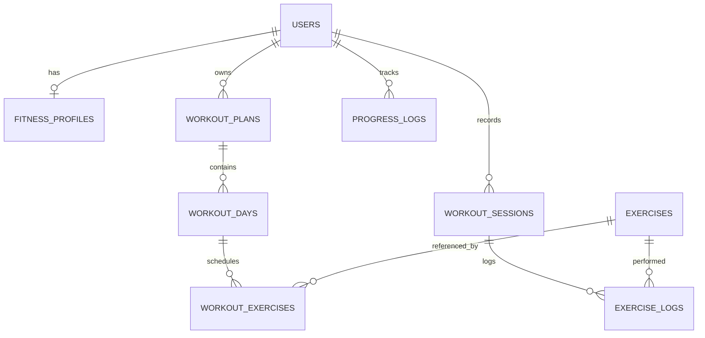

[](https://fastapi.tiangolo.com/)
[](https://nextjs.org/)
[](https://www.typescriptlang.org/)
[](https://tailwindcss.com/)
[](https://www.sqlalchemy.org/)
[](https://openai.com/)

> **FitGenius AI** is an intelligent full-stack fitness and workout planning platform that synthesizes personalized, evidence-based training programs based on user physical metrics, fitness goals, experience level, equipment access, and weekly availability.

---

## 📸 Design & UI Aesthetics

Inspired by elite fitness platforms (**CerbroFit on Dribbble**, **HealthVibe on Behance**, and **Workouter**):
- **Sleek Obsidian Theme**: Dark mode palette (`#090D16` / `#111726`) with luminous neon emerald (`#10B981`) and cyan (`#06B6D4`) accents.
- **Glassmorphic Cards**: Frosted semi-transparent panels with crisp border contrasts.
- **Live Interactive HUD**: Active session timer, set-by-set weight/reps tracking, and audible Web Audio rest interval countdown stopwatch.
- **Progressive Analytics**: SVG weight trajectory charts, cumulative tonnage lifted, and workout consistency streaks.

---

## ⚡ Key Features

### 1. User Authentication & Profile
- Secure JWT bearer token authentication with `bcrypt` password hashing.
- Personalized athlete profiles with physical characteristics (Age, Gender, Height, Current Weight, Target Weight).
- Instant 1-click **Demo Account** (`demo@fitgenius.ai` / `password123`).

### 2. Interactive Fitness Questionnaire & Onboarding
- 4-step guided onboarding wizard:
  - **Step 1**: Physical metrics (Age, Gender, Height, Current & Target Weight).
  - **Step 2**: Primary Goal (Muscle Gain, Fat Loss & Conditioning, Raw Strength, Maintenance).
  - **Step 3**: Experience Level (Beginner, Intermediate, Advanced) and Session Duration (30, 45, 60, 90 mins).
  - **Step 4**: Training Frequency (1 to 7 days/week) and Equipment (Full Gym, Home with Dumbbells & Bench, Dumbbells Only, Bodyweight Only).
- Automatically triggers AI plan generation upon completion.

### 3. AI Workout Generator (Core Feature)
- Dual-Mode Engine:
  - **OpenAI API (GPT-4o-mini)**: Uses structured JSON schema prompting to produce periodized splits.
  - **Built-in Expert Sports Science Engine**: Algorithmic fallback ensuring 100% reliability offline without requiring an OpenAI API key.
- **Safety & Recovery Validator**:
  - Automatically enforces 48-hour recovery separation for major muscle groups.
  - Strictly constrains exercise selection to available user equipment.
  - Caps daily volume to manageable limits (max 8 exercises per session) to prevent overtraining.
- Plan regeneration studio with custom notes and muscle priority tuning.

### 4. Searchable Exercise Library
- Catalog of 35+ pre-seeded compound and isolation exercises.
- Real-time search across exercise names, equipment, and technique cues.
- Filter chips for muscle groups: *Chest, Back, Legs, Shoulders, Biceps, Triceps, Core, Cardio*.
- Detail modal featuring step-by-step instructions, biomechanics cues, and difficulty ratings.

### 5. Interactive Live Workout Tracker
- **Elapsed Session Stopwatch**: Counts total session time in real time.
- **Audible & Visual Rest Interval Timer**: Automatically activates when checking off sets with Web Audio chime cues and `+30s` extenders.
- **Set-by-Set Logging**: Records weight (kg), reps completed, and Rate of Perceived Exertion (RPE).
- **Dynamic Volume Computation**: Calculates cumulative weight lifted ($Volume = \sum Weight \times Reps$).
- **Session Celebration Modal**: Rate workout intensity (1-5 stars) and save performance logs to database.

### 6. Progress Dashboard & Trajectory
- Key Performance Indicators: Current Weight, Net Delta, Target Objective, Streak Days, and Completion Rate.
- Interactive SVG weight progression curve with target objective reference lines.
- Complete measurement logger (Weight, Body Fat %, Chest, Waist, Arms, Notes).

### 7. Workout History & Archive
- Detailed past workout session breakdown with individual exercise sets and weights.
- Archive of previously generated AI plans with 1-click **"Re-Activate Plan"** capability.

---

## 🛠️ Technology Stack

| Layer | Technology | Role |
| :--- | :--- | :--- |
| **Frontend** | Next.js 16 (App Router) | React Framework with Webpack WASM engine |
| **UI Library** | React 19, TypeScript | Reactive interface and strict type safety |
| **Styling** | Tailwind CSS v4, Lucide Icons | Obsidian glassmorphism & responsive design |
| **Backend** | Python 3.13, FastAPI | High-performance asynchronous REST API |
| **ORM & DB** | SQLAlchemy 2.0, SQLite / PostgreSQL | Relational data persistence & migrations |
| **Auth** | PyJWT, Bcrypt | Token signing & cryptographically secure hashing |
| **AI Integration**| OpenAI API (GPT-4o-mini) + Expert Rule Fallback | Weekly workout programming |

---

## 🗄️ Database Schema Design



### Table Definitions:
1. `users`: User identity, email, password hash, timestamps.
2. `fitness_profiles`: Age, gender, height, weight, goal, experience, days/week, equipment, session duration.
3. `exercises`: Catalog of 35+ exercises with biomechanics cues, equipment, difficulty, instructions.
4. `workout_plans`: AI-generated programs, goal, days/week, rationale, active status.
5. `workout_days`: Day 1-7 schedules, focus muscle groups, rest day flags.
6. `workout_exercises`: Assigned exercises, sets, reps, rest intervals, target RPE.
7. `workout_sessions`: Completed live sessions, total volume (kg), duration, rating.
8. `exercise_logs`: Actual weight and repetitions logged per set.
9. `progress_logs`: Body weight and circumference logs over time.

---

## 🚀 Quick Start Guide

### Prerequisites
- Node.js 18+ & npm
- Python 3.10+
- (Optional) Docker & Docker Compose

### 1. Clone & Set Up Backend

```bash
cd backend
python -m venv venv

# Windows
.\venv\Scripts\activate
# Linux/macOS
source venv/bin/activate

pip install -r requirements.txt
uvicorn app.main:app --reload --port 8000
```
*The backend automatically creates all SQLite database tables and seeds 35+ exercises and the demo account upon initial startup!*

### 2. Set Up Frontend

```bash
cd frontend
npm install
npm run dev
```

Open [http://localhost:3000](http://localhost:3000) in your browser.

### 3. Demo Credentials
- **Email**: `demo@fitgenius.ai`
- **Password**: `password123`
*(Or click the "Click to fill Demo Account credentials" button on the login screen).*

---

## 🐳 Docker Deployment

To launch the full stack (FastAPI + PostgreSQL + Next.js) using Docker Compose:

```bash
docker-compose up --build
```

- **Frontend**: http://localhost:3000
- **Backend API Docs (Swagger)**: http://localhost:8000/docs
- **Health Check**: http://localhost:8000/health

---

## 📝 CV / Portfolio Summary

> **FitGenius AI — AI-Powered Fitness and Workout Planning Platform**  
> Designed and developed a full-stack fitness web application that leverages artificial intelligence to generate personalized workout programs based on users' physical characteristics, fitness goals, training experience, and available equipment.  
> **Key Technologies**: Next.js, React, TypeScript, Tailwind CSS, Python, FastAPI, SQLAlchemy, PostgreSQL, OpenAI API, JWT.  
> **Key Features**:  
> - AI-powered personalized workout generation with sports-science recovery rules.  
> - User authentication and fitness profile onboarding.  
> - Searchable exercise library with anatomy cues and 35+ movements.  
> - Interactive live workout session tracker with Web Audio rest intervals.  
> - Weight progression analytics with interactive SVG trajectories.
